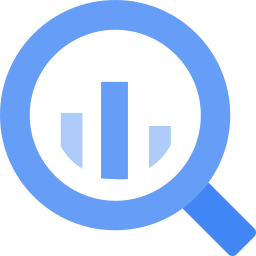
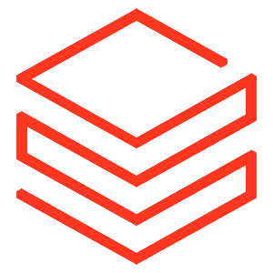
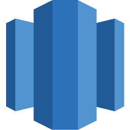
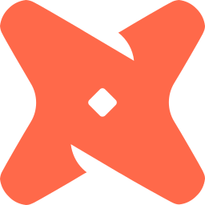
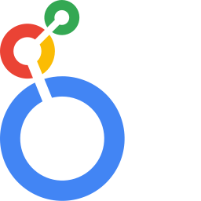
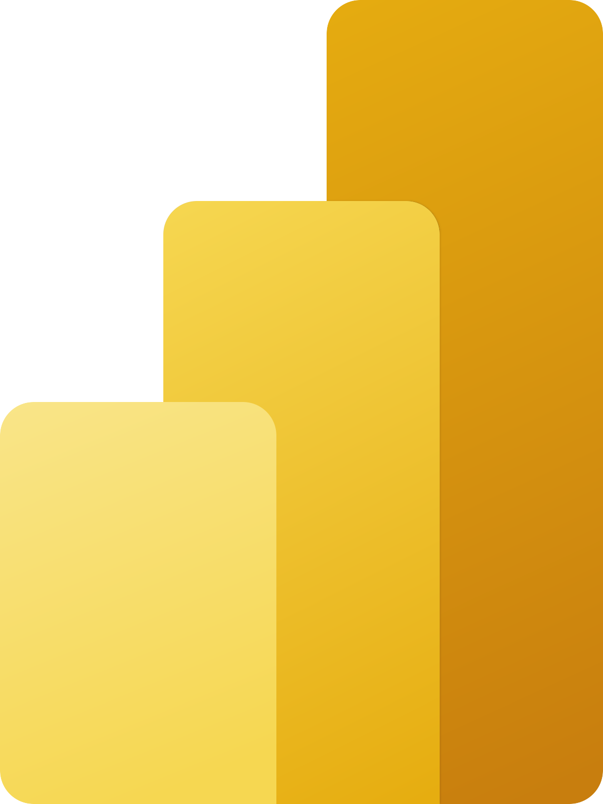
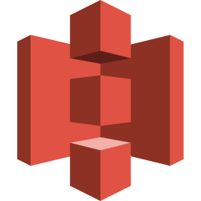
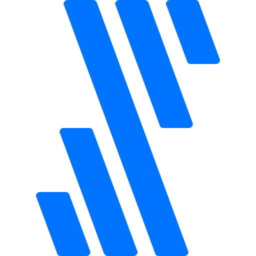

<p align="center">
  <a href="https://github.com/Dxlxz/orrery">
    
  </a>
</p>

<p align="center">
  <a href="https://github.com/Dxlxz/orrery/actions/workflows/build-and-test.yml"></a>
  <a href="https://pypi.org/project/orrery/"></a>
  <a href="https://pypi.org/project/orrery/"></a>
  <a href="https://hub.docker.com/r/acryldata/orrery-gms"></a>
  <a href="https://orrery.dev/slack/?utm_source=github&utm_medium=readme&utm_campaign=github_readme&utm_content=header-slack-badge"></a>
  <a href="https://github.com/Dxlxz/orrery/stargazers"></a>
  <a href="https://github.com/Dxlxz/orrery/blob/master/LICENSE"></a>
</p>

<p align="center">
  <a href="#quick-start"><b>Quickstart</b></a> ·
  <a href="https://demo.orrery.dev/?utm_source=github&utm_medium=readme&utm_campaign=github_readme&utm_content=nav-live-demo"><b>Live Demo</b></a> ·
  <a href="https://tours.orrery.dev/?utm_source=github&utm_medium=readme&utm_campaign=github_readme&utm_content=tours-top-links"><b>Product Tours</b></a> ·
  <a href="https://docs.orrery.dev/?utm_source=github&utm_medium=readme&utm_campaign=github_readme&utm_content=nav-docs"><b>Docs</b></a> ·
  <a href="https://orrery.dev/slack/?utm_source=github&utm_medium=readme&utm_campaign=github_readme&utm_content=nav-slack"><b>Slack Community</b></a>
</p>

<p align="center">
  <i>Maintained by <a href="https://github.com/Dxlxz">Dxlxz</a></i> · <a href="https://github.com/Dxlxz/orrery">⭐ Star on GitHub</a>
</p>

# Orrery

**Orrery is a self-hosted metadata platform** — a graph of your datasets, pipelines, dashboards and their owners, with column-level lineage, a search-first catalog and event-driven metadata APIs.

It is a ground-up rebrand of the open-source Orrery platform (Apache 2.0), renamed end to end and delivering a single deployable stack: the metadata graph, 150+ ingestion connectors, the GraphQL API, the React catalog UI and the Python CLI, all under the Orrery name.

```bash
python -m pip install orrery          # ingestion + CLI
orrery docker quickstart              # full local stack
```

See the [quick start](#quick-start) for the supported path, or the [architecture notes](docs/architecture/architecture.md) for how the pieces fit together.

<p align="center">
  <a href="https://tours.orrery.dev/?utm_source=github&utm_medium=readme&utm_campaign=github_readme&utm_content=tours-hero">
    
  </a>
</p>

<p align="center">
  Trusted in production by teams at Netflix, Visa, Etsy, Slack, Apple, FIS, Miro, and <a href="https://orrery.dev/resources/customer-stories/?utm_source=github&utm_medium=readme&utm_campaign=github_readme&utm_content=intro-adopters">3,000+ organizations worldwide →</a> · <a href="ADOPTERS.md">See all adopters</a>
</p>

## Pick your path

### Orrery OSS

Self-host on your own infrastructure. Apache 2.0 licensed. Full access to the metadata graph, 150+ integrations, column-level lineage, governance, and discovery. Best for teams that want full control and are comfortable running their own stack.

[Run it locally ↓](#quick-start) · [Quickstart guide →](https://docs.orrery.dev/docs/quickstart?utm_source=github&utm_medium=readme&utm_campaign=github_readme&utm_content=path-oss-quickstart) · [Deploy on Kubernetes →](https://docs.orrery.dev/docs/deploy/kubernetes)

### Orrery Cloud

Managed, SLA-backed, enterprise-ready. Access data observability and the full Context Platform: Context Intelligence, Context Hub, and native agent integrations out of the box. No infrastructure to run.

[Start a free trial →](https://orrery.dev/free-trial/?utm_source=github&utm_medium=readme&utm_campaign=github_readme&utm_content=path-cloud-trial) · [Compare OSS vs Cloud →](https://docs.orrery.dev/docs/managed-orrery/managed-orrery-overview)

## Core capabilities

### Context Platform

Turn your data estate into a trusted knowledge base for AI agents.

- **Context Ingestion** pulls metadata from 150+ integrations, dbt, Power BI, Confluence, Notion into a unified context graph
- **Context Intelligence** mines years of query history to build a semantic index of how your organization actually uses its data; no manual authoring required
- **Context Hub** - a workspace where domain experts review, approve, and enrich AI-proposed context before it reaches any agent
- **Context Activation** serves validated context to any agent via Model Context Protocol (MCP), GraphQL, API, or SDK

[Learn more about the Context Platform →](https://orrery.dev/products/context-platform/?utm_source=github&utm_medium=readme&utm_campaign=github_readme&utm_content=capabilities-context-platform)

### Discovery

Find the right data, fast.

- Universal search using natural language across your entire data estate
- Column-level lineage to trace data from source to consumption
- Data profiling: schema, statistics, ownership, usage in one place

[Learn more about Discovery →](https://orrery.dev/products/data-discovery/?utm_source=github&utm_medium=readme&utm_campaign=github_readme&utm_content=capabilities-discovery)

### Governance

Make data trustworthy at scale.

- Business glossary with shared definitions, owned and versioned
- Ownership and stewardship for every asset
- Access policies and compliance controls

[Learn more about Governance →](https://orrery.dev/products/data-governance/?utm_source=github&utm_medium=readme&utm_campaign=github_readme&utm_content=capabilities-governance)

### Observability

Know when something breaks before your users do.

- Data quality assertions and monitoring
- Freshness checks and SLA tracking
- Incident tracking and root cause lineage

[Learn more about Observability →](https://orrery.dev/products/data-observability/?utm_source=github&utm_medium=readme&utm_campaign=github_readme&utm_content=capabilities-observability)

[→ See the full product tour at orrery.dev](https://orrery.dev/product-tour/?utm_source=github&utm_medium=readme&utm_campaign=github_readme&utm_content=capabilities-product-tour)

## Quick start

- [**Try the live demo →**](https://demo.orrery.dev/?utm_source=github&utm_medium=readme&utm_campaign=github_readme&utm_content=quickstart-live-demo) No installation required.

- **Run locally.** Requires Docker (8GB RAM) and Python 3.10+.

  ```sh
  pip install orrery
  orrery docker quickstart
  # → http://localhost:9002 (username: orrery, password: orrery)
  ```

  [Full quickstart guide →](https://docs.orrery.dev/docs/quickstart)

- **Connect your AI assistant via MCP.** Add the Orrery MCP server to your MCP client (Claude Desktop, Cursor, and more).

  ```sh
  uvx mcp-server-orrery@latest
  ```

  [MCP server setup →](https://docs.orrery.dev/docs/features/feature-guides/mcp)

**Next steps:** [Ingest metadata](https://docs.orrery.dev/docs/metadata-ingestion/cli-ingestion) · [Search the catalog](https://docs.orrery.dev/docs/api/tutorials/sdk/search_client) · [Query lineage](https://docs.orrery.dev/docs/api/tutorials/lineage) · [Add documentation](https://docs.orrery.dev/docs/api/tutorials/descriptions)

## Why Orrery

- **Cross-platform by design.** Orrery started at LinkedIn in 2019 to manage metadata at hyperscale. That foundation with column-level lineage across 150+ integrations, spanning your entire data estate is what makes trusted context possible. Context is only as good as the lineage underneath it, and lineage is only as good as its coverage.

- **Battle-tested at scale.** Born at LinkedIn to handle one of the largest data estates in the world. Manages 10M+ assets in production today.

- **Accuracy you can measure.** Customers report text-to-SQL accuracy improving from 50% to 90% after connecting Orrery. 119% more AI/ML models reach production when teams can trust their data. _([IDC, March 2026](https://orrery.dev/roi/?utm_source=github&utm_medium=readme&utm_campaign=github_readme&utm_content=why-roi-accuracy))_

- **Discovery that actually works.** Business users find trusted data in five minutes, down from 50 — a 91% reduction in search time. _([IDC, March 2026](https://orrery.dev/roi/?utm_source=github&utm_medium=readme&utm_campaign=github_readme&utm_content=why-roi-discovery))_

- **Open by default, extensible by design.** Apache 2.0. Built on open standards: MCP for agent delivery, GraphQL and REST APIs. Bring your own agents, your own LLM, your own stack.

[Compare Orrery Core and Orrery Cloud →](https://orrery.dev/products/cloud-vs-core/?utm_source=github&utm_medium=readme&utm_campaign=github_readme&utm_content=why-cloud-vs-core)

## Integrations

Production-grade integrations across your full data stack.

<p align="center">
  &nbsp;&nbsp;
  &nbsp;&nbsp;
  &nbsp;&nbsp;
  &nbsp;&nbsp;
  &nbsp;&nbsp;
  &nbsp;&nbsp;
  &nbsp;&nbsp;
  &nbsp;&nbsp;
  &nbsp;&nbsp;
  &nbsp;&nbsp;
  &nbsp;&nbsp;
  &nbsp;&nbsp;
</p>

<p align="center">
  <a href="https://docs.orrery.dev/integrations"><b>See all 150+ integrations →</b></a>
</p>

Missing a source? [Build a custom connector](https://docs.orrery.dev/docs/how/add-custom-ingestion-source). [Orrery Skills](https://github.com/Dxlxz/orrery-skills) can help your AI coding assistant plan and review it.

## Orrery ecosystem

- **[Analytics Agent](https://github.com/Dxlxz/analytics-agent)** – Open-source agent grounded in your Orrery catalog. Ask data questions in plain English and get SQL, results, and charts back. Apache 2.0, bring your own LLM.
- **[MCP Server](https://github.com/dxlxz/orrery-mcp)** – The official Model Context Protocol server for Orrery.
- **[Orrery Skills](https://github.com/Dxlxz/orrery-skills)** – Agent skills for working with Orrery: search, lineage, enrichment, and quality workflows.

[See the full ecosystem →](docs/ecosystem.md)

## Built by the community

Orrery has 16,000+ community members and 750+ contributors across 3,000+ organizations. Every connector, integration, and improvement you use was built by people like you.

- Join [Slack](https://orrery.dev/slack/?utm_source=github&utm_medium=readme&utm_campaign=github_readme&utm_content=community-slack) community
- Watch demos and events on [YouTube](https://www.youtube.com/@OrreryCloud)
- Register to [Monthly Town Hall](https://orrery.dev/community/orrery-town-halls/?utm_source=github&utm_medium=readme&utm_campaign=github_readme&utm_content=community-town-hall)
- Read our [Blog](https://orrery.dev/blog/?utm_source=github&utm_medium=readme&utm_campaign=github_readme&utm_content=community-blog)
- Learn from teams using Orrery in [case studies and talks](docs/links.md)
- Found a bug? [Open an issue](https://github.com/Dxlxz/orrery/issues)

Ready to contribute? See [CONTRIBUTING.md](docs/CONTRIBUTING.md) for guidelines and the [Developer's Guide](https://docs.orrery.dev/docs/developers) to set up your local development environment.

## Explore Orrery Now

[Live Demo](https://demo.orrery.dev/?utm_source=github&utm_medium=readme&utm_campaign=github_readme&utm_content=footer-live-demo) · [Docs](https://docs.orrery.dev/?utm_source=github&utm_medium=readme&utm_campaign=github_readme&utm_content=footer-docs) · [Slack](https://orrery.dev/slack/?utm_source=github&utm_medium=readme&utm_campaign=github_readme&utm_content=footer-slack) · [LinkedIn](https://www.linkedin.com/company/orrery-cloud/) · [X](https://x.com/OrreryCloud) · [Security](https://docs.orrery.dev/docs/security) · [Feature Requests](https://orreryspace.slack.com/archives/C02FWNS2F08) · [⭐ Star us on GitHub](https://github.com/Dxlxz/orrery)

## License

Apache License 2.0 — see [LICENSE](LICENSE). Third-party attributions are in [NOTICE](NOTICE).

Copyright 2026 Dxlxz. Orrery is an independent rebranded derivative of the Orrery platform; the original work is copyright 2015-2026 LinkedIn Corporation and the Orrery Project Authors and remains under the same Apache 2.0 licence. "Orrery" is a trademark of its respective owners and is used only to describe that origin — Orrery is not affiliated with or endorsed by LinkedIn Corporation or Orrery, Inc.
